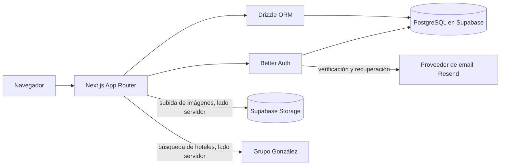

# Soleando DR

**Plataforma de viajes en desarrollo para descubrir hoteles, excursiones, paquetes y cruceros desde una misma experiencia digital.**

El producto busca resolver una tarea concreta: reunir la oferta de viajes de Soleando en un catálogo claro y administrable, y dirigir cada consulta al canal adecuado. El catálogo debe mostrar información confirmada por el equipo. La reserva de hoteles continúa en el portal de Grupo González; esta aplicación no confirma disponibilidad, procesa pagos ni almacena esas reservas.

Soleando DR sigue en desarrollo. Este repositorio no demuestra adopción por clientes ni que el producto esté terminado. La [interfaz de referencia](https://soleando-dr-landing-page.vercel.app/) permite revisar el despliegue asociado al proyecto; no implica que el servicio se ofrezca a clientes.

## Estado y funcionalidades

| Área | Implementación visible | Cobertura o límite conocido |
| --- | --- | --- |
| Catálogo | Administración de tours o paquetes, excursiones nacionales e internacionales y cruceros; estados borrador, publicado y archivado. | La suite de integración crea, edita, publica y archiva elementos, y comprueba que los borradores no se exponen. El contenido de negocio debe ser cargado y confirmado por Soleando. |
| Cuentas | Registro e inicio de sesión con contraseña, sesiones, perfil y viajeros guardados; autorización administrativa por rol. | Las pruebas de integración cubren sesión, acceso por rol y aislamiento de viajeros. Registro y flujos externos requieren configuración propia. |
| Imágenes | Carga administrativa en Supabase Storage y optimización mediante `next/image`. | La integración aislada prueba permisos, límites de archivo, una subida real al Storage temporal y la ruta de optimización. |
| Búsqueda de hoteles | El servidor consulta destinos del motor de Grupo González y prepara la búsqueda para continuar en el portal del proveedor. | La suite valida el esquema de búsqueda, pero no prueba automáticamente el servicio externo ni una reserva final. |
| Email y Google | El código integra Resend para verificación y recuperación, y Better Auth con proveedor OAuth de Google cuando hay credenciales. | La suite no demuestra entrega de correos ni completa un inicio de sesión Google con una cuenta real. |

El último código validado corresponde al commit `61692c5`. En esta actualización documental pasaron `npm run typecheck` y `npm test` (6 validaciones, 2 pruebas HTTP y compilación). La integración Supabase aislada había pasado previamente para ese commit, pero no pudo repetirse en esta máquina porque Docker no inició su motor. La revisión visual registrada cubrió 7 páginas públicas en 14 anchos y el editor administrativo en esos 14 anchos.

### Trabajo técnico que se puede revisar

- Separación entre páginas y componentes de interfaz, acciones de servidor, validación de datos, acceso a PostgreSQL e integraciones externas.
- Autorización administrativa comprobada en el servidor y separación de datos de perfil y viajeros por cuenta.
- Flujo de edición del catálogo con validación, persistencia, publicación y revalidación de páginas.
- Pruebas de integración que levantan un Supabase efímero en Docker y limpian sus propios contenedores, volúmenes y archivos.

El historial de Git permite revisar la autoría de cada cambio y su evolución en el tiempo.

### Pendiente de validar para un lanzamiento

- Entrega real de verificación y recuperación por Resend, con dominio y remitente aprobados.
- Flujo completo OAuth de Google con las credenciales y callbacks del dominio de destino.
- Búsqueda y continuidad de reserva en el proveedor hotelero en cada entorno; la finalización ocurre fuera de Soleando.
- Contenido comercial real, actualizado y autorizado para publicar.
- Procedimiento operativo de respaldo y restauración de la base de datos.

El proyecto ya no sincroniza Instagram, no incluye catálogo hotelero simulado, no instala una PWA y no mantiene un módulo propio de reservas.

## Tecnologías

| Tecnología | Uso en el proyecto |
| --- | --- |
| [Next.js 16](https://nextjs.org/docs) y [React 19](https://react.dev/learn) | App Router, páginas y componentes de la web. |
| [TypeScript](https://www.typescriptlang.org/docs/) | Tipado de interfaces y servicios. |
| [Tailwind CSS 4](https://tailwindcss.com/docs/installation/framework-guides/nextjs) | Estilos de la interfaz. |
| [PostgreSQL](https://www.postgresql.org/docs/) y [Supabase](https://supabase.com/docs) | Persistencia y almacenamiento de imágenes. |
| [Drizzle ORM](https://orm.drizzle.team/docs/overview) | Consultas del servidor y definición del acceso tipado a PostgreSQL. |
| [Better Auth](https://www.better-auth.com/docs) | Sesiones, autenticación con contraseña y OAuth. |
| [Zod](https://zod.dev/) | Validación de formularios y datos de entrada. |
| [Resend](https://resend.com/docs) | Proveedor de email transaccional en producción, si está configurado. |
| [Node.js](https://nodejs.org/api/test.html) y Docker | Runtime y pruebas de integración con servicios aislados. |

Versiones observadas en los manifiestos y el lockfile: Next.js 16.3.3, React 19, TypeScript 5.7.3, Tailwind CSS 4 y Drizzle ORM 0.45.2. El entorno usado en la validación fue Node.js 24; el repositorio no declara un campo `engines` en `package.json`.

## Arquitectura resumida



### Decisiones técnicas reflejadas en el código

- **Lecturas públicas en el servidor:** las páginas del catálogo llaman al repositorio, que consulta solo elementos publicados. Las acciones del catálogo y la carga de imágenes vuelven a comprobar el rol administrador en el servidor.
- **Identidad y datos persistentes:** Better Auth guarda sesiones y cuentas en PostgreSQL; Drizzle accede a las tablas del catálogo, perfiles y viajeros. Supabase se usa además para alojar las imágenes. El código muestra esta distribución, aunque no registra una decisión histórica que compare Better Auth con Supabase Auth.
- **Proveedor hotelero detrás de una ruta propia:** la interfaz usa un endpoint de Next.js que valida entradas, controla errores y realiza las solicitudes hacia Grupo González desde el servidor.
- **Validación en límites de datos:** Zod valida los datos de entrada antes de guardarlos o enviar una búsqueda al proveedor.
- **Pruebas aisladas:** la prueba de integración levanta Supabase temporal en Docker con las migraciones del repositorio, para ejercitar permisos y persistencia sin usar datos productivos.

No hay registros de decisiones arquitectónicas (ADR) que permitan atribuir motivos de negocio o comparaciones de tecnologías más allá de lo que muestra la implementación.

## Capturas que vale la pena agregar

No hay capturas de pantallas de producto versionadas actualmente. Para documentar la interfaz sin fabricar resultados, se recomienda capturarlas desde la aplicación real cuando estén disponibles:

1. Portada en escritorio y móvil, para mostrar navegación y jerarquía visual.
2. Búsqueda hotelera con sugerencias actuales devueltas por el proveedor, sin datos personales.
3. Editor de catálogo en el panel administrativo, con información autorizada para mostrar.
4. Catálogo y detalle de una excursión o crucero después de publicar contenido comercial confirmado.

No incluir credenciales, datos de clientes, formularios personales ni contenido de prueba como si fuese una oferta real.

## Estructura del repositorio

| Ruta | Responsabilidad |
| --- | --- |
| [`app/`](app) | Páginas, layouts, acciones de servidor y endpoints HTTP. |
| [`components/`](components) | Interfaces pública, de cuenta y de administración. |
| [`features/`](features) | Catálogo, hoteles, correo, perfil y viajeros. |
| [`lib/`](lib) | Autenticación, conexión y esquema de datos. |
| [`supabase/migrations/`](supabase/migrations) | Historial versionado de la base de datos y Storage. |
| [`tests/`](tests) | Pruebas de validación, rutas e integración aislada. |
| [`docs/`](docs) | Auditorías y guías operativas complementarias. |

Las migraciones incluyen cambios históricos de eliminación y evolución del producto. No deben eliminarse ni ejecutarse selectivamente en una base con datos sin revisar el estado de esa base.

## Instalación local

Requisitos: Node.js 24 y una base PostgreSQL de desarrollo con las migraciones de [`supabase/migrations/`](supabase/migrations) aplicadas. El archivo [`supabase/config.toml`](supabase/config.toml) describe la configuración local de Supabase. No apuntes el entorno local a la base de producción.

```bash
git clone https://github.com/CalosDev/soleando-dr.git
cd soleando-dr
npx --yes pnpm@10.30.2 install --frozen-lockfile
```

Copia `.env.example` como `.env.local` y asigna valores propios de desarrollo. El archivo de ejemplo contiene placeholders: en especial, `DATABASE_URL` debe coincidir con la instancia local; `BETTER_AUTH_SECRET` debe ser un secreto aleatorio; y los datos de Supabase son opcionales hasta que se prueben cargas de imágenes. Google y Resend pueden permanecer sin configurar durante el trabajo local.

```bash
npm run dev
```

Abre [http://localhost:3000](http://localhost:3000). Sin una base configurada pueden mostrarse páginas públicas y estados vacíos; las cuentas, la persistencia del catálogo y sus cambios requieren PostgreSQL disponible.

## Variables de entorno

Consulta [`.env.example`](.env.example) para la lista de nombres. Configura secretos únicamente en el entorno seguro donde se ejecute la aplicación.

| Variables | Uso |
| --- | --- |
| `DATABASE_URL`, `BETTER_AUTH_SECRET`, `BETTER_AUTH_URL` | Conexión a PostgreSQL y sesiones de Better Auth. |
| `NEXT_PUBLIC_APP_URL` | URL canónica del dominio asignado al entorno. |
| `SUPABASE_URL`, `SUPABASE_SERVICE_ROLE_KEY` | Carga de imágenes al bucket `soleando-media`; uso solo en el servidor. No añadir prefijo `NEXT_PUBLIC_` a la clave. |
| `EMAIL_PROVIDER=resend`, `RESEND_API_KEY`, `EMAIL_FROM` | Correo transaccional en producción. El dominio del remitente debe estar verificado. `EMAIL_REPLY_TO` es opcional. |
| `GOOGLE_CLIENT_ID`, `GOOGLE_CLIENT_SECRET` | Inicio de sesión OAuth web. Registrar `${BETTER_AUTH_URL}/api/auth/callback/google` como callback en Google. Esta aplicación usa Better Auth, no el callback de Supabase Auth. |

Al cambiar `SUPABASE_URL`, reconstruye la aplicación para que Next.js actualice los dominios permitidos de imágenes. `SOLEANDO_LOCAL_INTEGRATION=1` se reserva para la suite aislada y no debe configurarse en Vercel.

El acceso administrativo comienza en `/admin` y requiere el rol `admin`. [`scripts/create-admin.mjs`](scripts/create-admin.mjs) sirve para el alta inicial controlada; no contiene una contraseña permanente. En el editor, las etapas de una experiencia se escriben como `horario o día | título | descripción`, una por línea; los puertos de un crucero se escriben uno por línea. Publica solo precios, fechas e inclusiones confirmados.

## Pruebas

```bash
npm run typecheck
npm test
npm run test:integration
```

- `npm run typecheck`: comprueba los tipos TypeScript.
- `npm test`: ejecuta validadores y pruebas HTTP; el script de rutas incluye una compilación de producción.
- `npm run test:integration`: necesita Docker Desktop y los puertos 55320–55329, 55330 y 8583 libres. Construye la aplicación, crea un Supabase temporal con las migraciones del repositorio y verifica sesiones, perfiles, aislamiento de viajeros, permisos, carga y optimización de imágenes, y operaciones del catálogo. También comprueba borradores, duplicados, campos de cruceros y sitemap.

La primera integración puede descargar la CLI de Supabase fijada en 2.117.0 y las imágenes requeridas. Las cuentas de prueba se crean solo en la base temporal con contraseñas aleatorias. No se prueba envío real de email ni OAuth de Google. La suite no copia archivos de entorno ni metadatos de enlace remoto y limpia los contenedores, volúmenes y archivos que crea.

Detén `next dev` de este mismo checkout antes de lanzar las pruebas que compilan, para evitar escrituras simultáneas sobre los tipos generados y la caché. Si interrumpes la suite durante la limpieza, identifica el proyecto concreto `soleando-test-*` de esa ejecución y detén únicamente ese proyecto con `supabase stop --project-id <id> --no-backup`.

## Documentación relacionada

- [Infraestructura de email](docs/email-infrastructure.md)
- [Runbook de incidencias de email](docs/runbooks/email-delivery.md)
- [Auditoría intermedia de Fase 15A](docs/audits/phase-15a-audit.md): documento histórico; sus referencias a integraciones y pruebas pueden no representar el estado actual del repositorio.
- [Documentación de Next.js](https://nextjs.org/docs)
- [Aprender Next.js](https://nextjs.org/learn)
